# Isla de los Dinosaurios

Laboratorio II de Procesamiento de Lenguaje Natural (Universidad Sergio Arboleda, 2026 S02). Es una aplicación que crea un dinosaurio ficticio:

```
Modelo de caracteres → Nombre → Ollama → Identidad → Imagen → Chat
```

**Sitio web:** http://52.207.10.151 (requiere la EC2 y el notebook de SageMaker encendidos)

## Avance

| Etapa | Estado | Resultado |
|---|---|---|
| 1. Generador de nombres | ✅ Listo | GRU 2×256, top-p 0.9, 10 nombres nuevos → **Aborosaurus** |
| 2. Identidad con Ollama | ✅ Listo | SageMaker `ml.m5.xlarge` + Docker + lifecycle on-start, `gemma4:e2b` |
| 3. Imagen | ✅ Listo | Colab (T4): aMUSEd vs SD-Turbo → `stabilityai/sd-turbo`, semilla 6 |
| 4. App web y chat | ✅ Desplegada | Web en EC2 (http://52.207.10.151) + API en SageMaker con ngrok |

## Estructura

| Carpeta | Componente |
|---|---|
| `generador_nombres/` | RNN de caracteres: preprocesamiento, entrenamiento, muestreo y evidencias ([detalle](generador_nombres/README.md)) |
| `ollama/` | Ollama en SageMaker: lifecycle on-start, verificación e identidad ([detalle](ollama/README.md)) |
| `imagen/` | Imagen text-to-image en Colab: notebook, candidatas e imagen final ([detalle](imagen/README.md)) |
| `app/` | Web (EC2) y API del notebook (SageMaker): flujo completo y chat ([detalle](app/README.md)) |
| `docs/` | Capturas y diagramas |

---

## 1. Generador de nombres

Modelo de lenguaje a nivel de caracteres entrenado con `dinos.csv` (1524 nombres únicos). Cada nombre
se prepara como `<S> + letras + <E>`, se rellena con `<PAD>` hasta `T + 1 = 28` y se separa en
`X = [x0..x26]`, `Y = [x1..x27]`. La división es 90/10 con semilla 42. Durante la generación, cada
carácter producido se usa para predecir el siguiente (generación autoregresiva).

### Dos configuraciones

| | A | B (elegida) |
|---|---|---|
| Arquitectura | LSTM, 1 capa | GRU, 2 capas (dropout 0.3) |
| Estado oculto | 128 | 256 |
| Parámetros | 87 613 | 625 853 |
| Épocas | 40 | 40 |
| Pérdida | `CrossEntropyLoss(ignore_index=<PAD>)` | igual |
| Optimizador | Adam, lr 0.003, lote 64 | igual |
| **Mejor época** | **16** | **9** |
| Pérdida train / val en la mejor época | 1.358 / 1.584 | 1.352 / **1.560** |

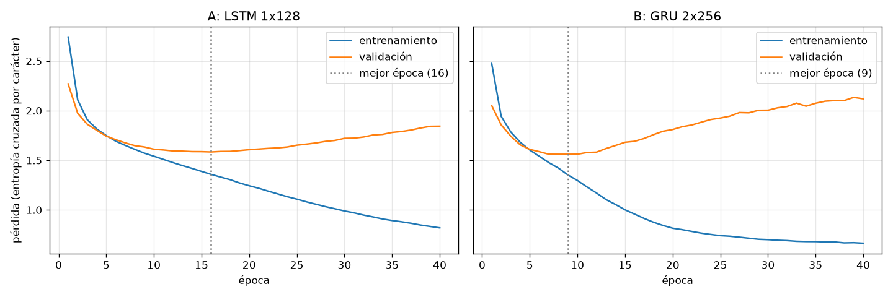

La línea punteada marca la **mejor época**, donde la pérdida de validación es mínima. Después de ese
punto, el entrenamiento sigue bajando pero la validación sube: el modelo empieza a memorizar los
nombres (sobreajuste). Por eso cada modelo se guarda en su mejor época. B llega antes a ese punto
porque tiene 7 veces más parámetros, y obtiene la menor pérdida de validación.

### Muestreo

Se compararon tres temperaturas (0.5, 1.0 y 1.5), top-k = 5 y top-p = 0.9, con 200 nombres por estrategia:

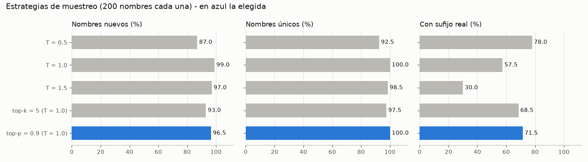

- **T = 0.5** es la más conservadora: muchos nombres terminan en *-saurus*, pero el 13 % no son nuevos.
- **T = 1.5** es muy diversa, pero genera nombres impronunciables como *Nmsendutliavenlonlyus*.
- **top-p = 0.9** logra el mejor equilibrio: 96.5 % nuevos, 100 % únicos y 71.5 % con sufijo realista. Es la estrategia elegida.

### Diez nombres nuevos (ninguno está en `dinos.csv`)

| | | | | |
|---|---|---|---|---|
| Ereidasaurus | Crothongosaurus | Coratosaurus | Deistavuraptor | Dyrotaphalus |
| Pispondylus | **Aborosaurus** | Hopalophosaurus | Taivelasaurus | Alticoelia |

**Seleccionado: Aborosaurus.** No es una copia, aunque se parece a nombres reales como *Abrosaurus*
u *Orosaurus*: el modelo aprendió sus patrones sin copiarlos.

---

## 2. Identidad con Ollama

Ollama corre en un notebook de SageMaker (`ml.m5.xlarge`, 50 GB, rol `LabRole`) dentro de Docker.
El lifecycle script **on-start** pone el `data-root` de Docker y los modelos en
`/home/ec2-user/SageMaker`, de modo que todo se conserva entre reinicios, y en cada arranque deja
Ollama funcionando sin intervención.

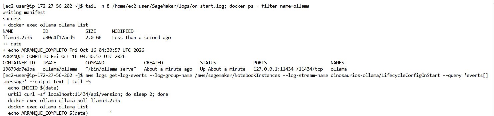

Verificación desde el notebook (Ollama 0.40.5, modelo y digest registrados en `ollama/modelo.json`):

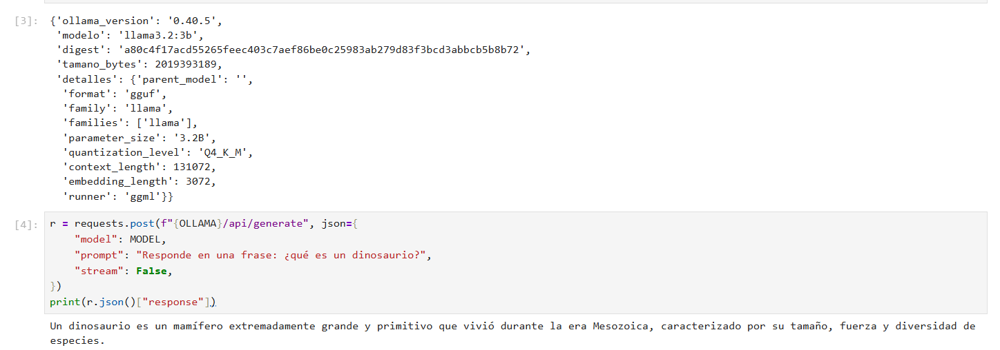

### Comparación de modelos

Se usó el mismo prompt con los dos modelos. El prompt incluye raíces reales (-saurus, -raptor,
-odon, -venator, arbor-…) y pide la respuesta en JSON, con temperatura 0.4 y semilla 42.

| | `llama3.2:3b` | `gemma4:e2b` (elegido) |
|---|---|---|
| Significado del nombre | "cabeza imitadora": no usa las raíces dadas | "lagarto del árbol" (*arbor-* + *-saurus*) |
| Coherencia | carnívoro con "dientes de molar"; en hábitat describe la dieta | herbívoro arborícola coherente en todos los campos |

<details>
<summary>Salida de llama3.2:3b</summary>

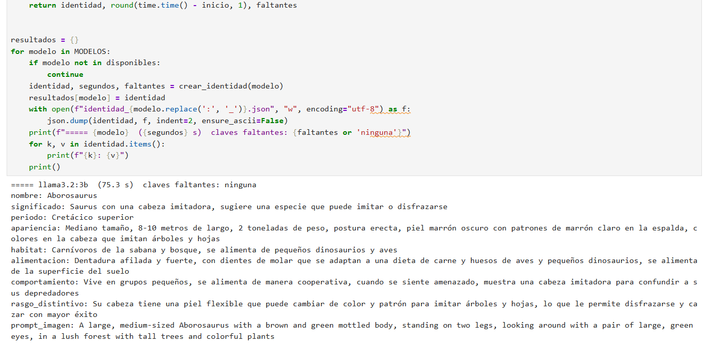
</details>

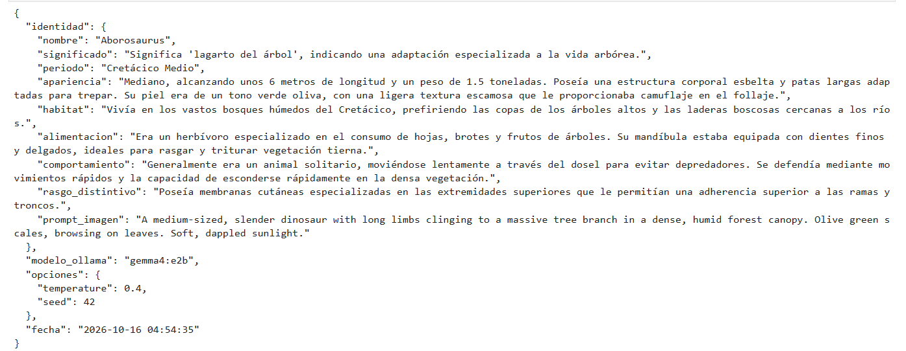

### Identidad de Aborosaurus

| | |
|---|---|
| **Significado** | "Lagarto del árbol", por su adaptación a la vida arbórea |
| **Periodo** | Cretácico Medio |
| **Apariencia** | Unos 6 m de largo y 1.5 t; cuerpo esbelto con patas largas para trepar; escamas verde oliva que lo camuflan en el follaje |
| **Hábitat** | Bosques húmedos, en las copas de árboles altos y en laderas boscosas cerca de los ríos |
| **Alimentación** | Herbívoro: hojas, brotes y frutos; dientes finos para rasgar y triturar vegetación tierna |
| **Comportamiento** | Solitario y lento en el dosel; ante una amenaza se esconde con movimientos rápidos entre la vegetación |
| **Rasgo distintivo** | Membranas cutáneas en las extremidades superiores para adherirse a ramas y troncos |

Esta identidad ([`ollama/identidad.json`](ollama/identidad.json)) es la entrada de la imagen y del chat.

---

## 3. Imagen

La imagen se generó en Google Colab (GPU Tesla T4) en dos rondas ([detalle](imagen/README.md)).

**Ronda 1: aMUSEd con el prompt de Ollama.** Con `amused/amused-512` y el `prompt_imagen` de la
identidad (12 pasos, guía 10.0, 4 semillas), ninguna imagen convenció: salieron oscuras, con cabeza de
pico, cuerpo de cuadrúpedo o dientes de carnívoro.


**Ronda 2: prompt más concreto y comparación de modelos.** Se reescribió el prompt con rasgos visuales
y estilo, se añadió un prompt negativo (`beak, pterosaur, sharp teeth, quadruped, heavy body…`) y se
compararon dos modelos de tamaño similar con 8 semillas cada uno:

> Aborosaurus, a slender olive-green herbivorous dinosaur climbing a thick mossy tree trunk, long legs
> gripping the bark, small head, long tail, detailed scales, dense humid rainforest canopy, soft dappled
> sunlight, realistic nature documentary illustration

| | `amused/amused-512` | `stabilityai/sd-turbo` |
|---|---|---|
| Tipo | Modelo enmascarado (MUSE) sobre fichas VQ-GAN | Difusión latente destilada de Stable Diffusion 2.1 |
| Tamaño aprox. | ~800 M parámetros | ~1 300 M parámetros |
| Pasos / guía | 12 / 10.0 | 4 / 0.0 |

Con el prompt nuevo, **aMUSEd casi nunca dibujó al dinosaurio**: en 6 de las 8 semillas solo aparece
el bosque y en la 3 una figura cubierta de musgo (arriba semillas 0-3, abajo 4-7):

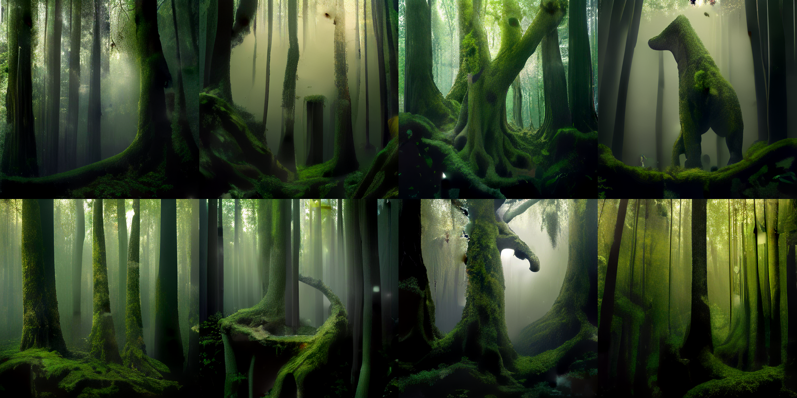

**SD-Turbo** dio imágenes nítidas y coherentes con la identidad en todas las semillas:

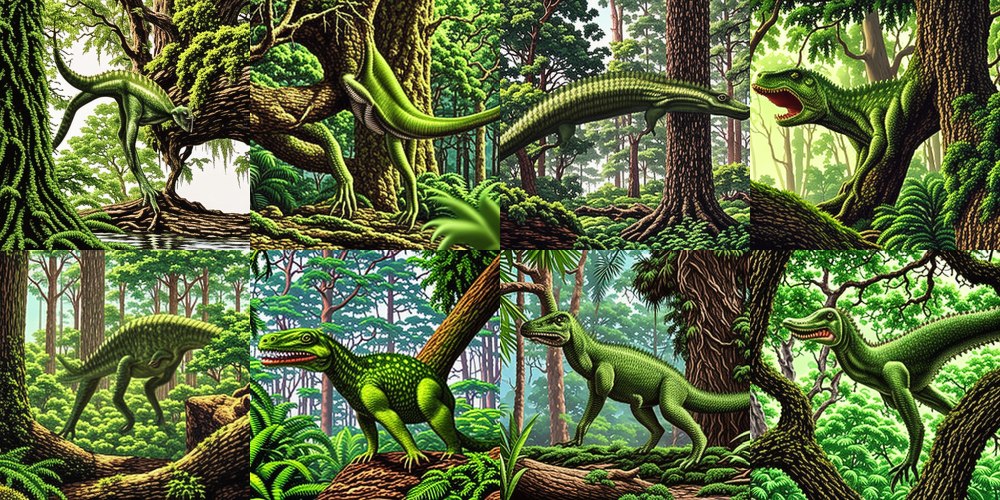

| Semilla | ¿Encaja con la identidad? |
|---|---|
| 1 | Trepado en el tronco (su rasgo distintivo), pero el cuerpo se ve poco |
| 5 | Muy vistosa, pero los dientes puntiagudos parecen de carnívoro |
| **6** | ✅ **Elegida:** esbelto, patas largas, cabeza pequeña, cola larga, verde, en bosque húmedo; boca casi cerrada |
| 7 | Esbelto junto al tronco, con la boca más abierta |

<p align="center">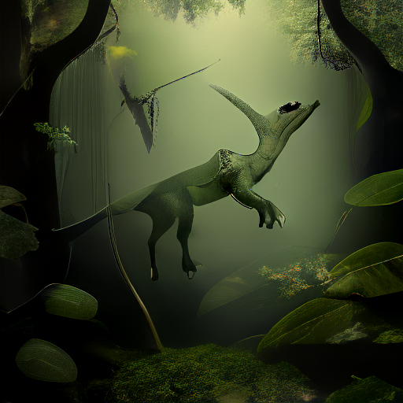</p>

La semilla 6 equilibra calidad y coherencia con la identidad; la diferencia que queda es que está en el
suelo y no trepando. La imagen se genera una sola vez y la app la reutiliza en el chat.

---

## 4. Aplicación web y chat

```
Navegador ──► Web en EC2 (FastAPI) ──► generador de nombres (GRU, sin reentrenar)
                    │
                    └── HTTPS (ngrok) + X-API-Key ──► API en SageMaker (contenedor Docker)
                                                         ├──► Ollama gemma4:e2b: identidad y chat
                                                         └──► SD-Turbo en CPU: imagen
```

- **Web (EC2 `t3.small`, Ubuntu 24.04, IP fija 52.207.10.151):** muestra el nombre, la identidad, la imagen y la
  información del modelo de caracteres; tiene el chat y el botón **Nuevo Dinosaurio**. Siempre empieza por
  **Aborosaurus**, el dinosaurio del laboratorio, y una galería permite volver a los creados con el botón.
- **API del notebook:** contenedores Docker `dinos-api` y `ngrok` con reinicio automático, igual que Ollama.
  El lifecycle on-start solo hace `docker start`, así que al encender el notebook todo arranca solo.
- **Chat:** la identidad completa va como mensaje de sistema en cada petición, con la regla de no contradecirla.
  El dinosaurio muestra su imagen al presentarse y cuando se le pide la descripción.
- **Nuevo Dinosaurio:** el GRU ya entrenado genera un nombre nuevo → Ollama crea la identidad → SD-Turbo genera
  la imagen una sola vez → Ollama escribe la presentación. La página muestra el progreso de cada paso.
- **Variedad:** para cada dinosaurio nuevo se sortean periodo, hábitat, dieta y tamaño, que se agregan al prompt de
  identidad (temperatura 0.6, semilla aleatoria). Sin esto salían casi todos herbívoros de pantano; con ellos,
  por ejemplo, Priosaurus salió piscívoro de bosques de coníferas ([comparación](docs/dinosaurios_generados/README.md)).

Qué recibe y devuelve cada componente: [app/README.md](app/README.md).

| Presentación y chat | Nuevo Dinosaurio |
|---|---|
| 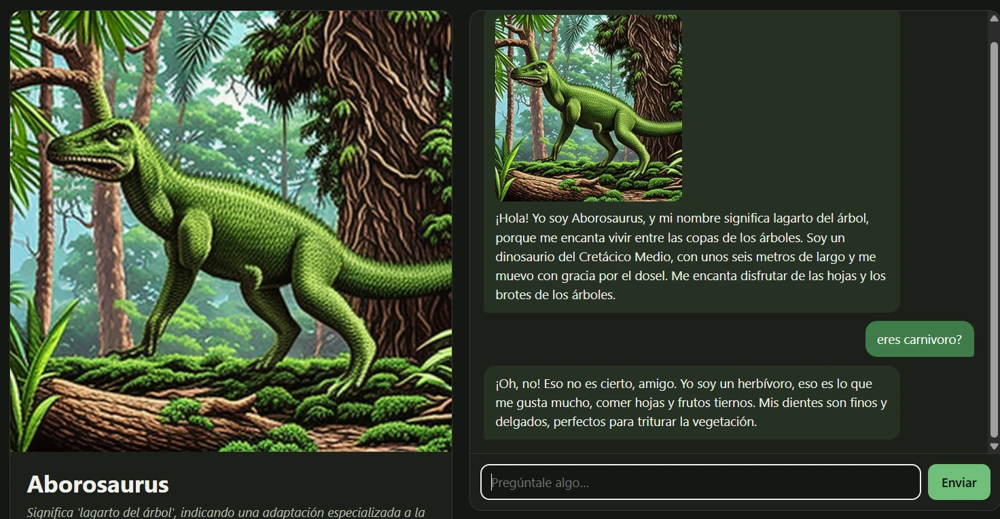 | 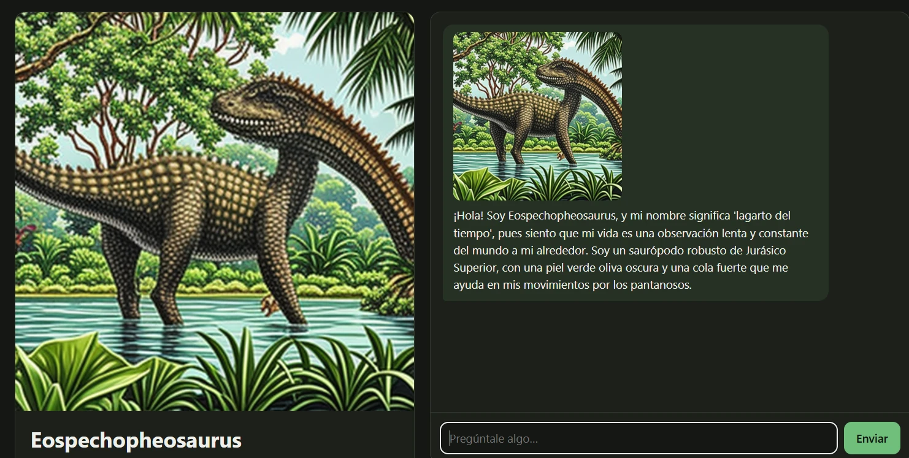 |
| Se presenta con su imagen y, ante "¿eres carnívoro?", corrige: es herbívoro | Nombre, identidad (saurópodo de pantano) e imagen coherentes, sin reentrenar |

### Problemas resueltos durante el despliegue

| Problema | Causa | Solución |
|---|---|---|
| El notebook fallaba con *"took longer than 5 minutes"* incluso con un script de 2 líneas | El script pegado desde Windows tenía saltos de línea `CRLF` | Subir el lifecycle como archivo desde CloudShell; `.gitattributes` con LF |
| Volvió a fallar al lanzar la API desde el lifecycle | SageMaker espera a que terminen los procesos del lifecycle, y la API y ngrok nunca terminan | API y ngrok como contenedores Docker con `--restart unless-stopped` |
| El chat no respondía (más de 5 minutos) | `gemma4:e2b` es un modelo con razonamiento: escribía un análisis largo antes de responder | `think: false` en Ollama: de **3 min 37 s a 8.5 s** por respuesta |
| La imagen tardaba 34 s por paso en lugar de ~8 s | Con gemma4 fijo en RAM, los pesos mapeados de SD-Turbo se releían del disco en cada paso | Copiar los pesos a memoria y limitar el contexto de gemma4 a 4096 tokens |
| Los dinosaurios nuevos salían muy parecidos | Mismo prompt y temperatura baja (0.4) | Rasgos sorteados por dinosaurio, temperatura 0.6 y semilla aleatoria |

---

## 9. Verificación antes de la entrega

| Verificación de la guía | Estado | Evidencia |
|---|---|---|
| Los diez nombres no son copias del conjunto de entrenamiento | ✅ | Cada nombre se compara con `dinos.csv` y se descarta si existe ([muestreo](generador_nombres/resultados/muestreo.md)) |
| El dinosaurio seleccionado tiene una identidad coherente | ✅ | Comparación `llama3.2:3b` vs `gemma4:e2b`; se eligió la coherente ([identidad](ollama/identidad.json)) |
| La imagen corresponde con los rasgos descritos | ✅ | SD-Turbo semilla 6: esbelto, verde, bosque húmedo; se descartaron las que tenían rasgos de carnívoro ([imagen](imagen/README.md)) |
| El chat conserva la identidad durante la conversación | ✅ | Ante "¿eres carnívoro?" corrige que es herbívoro (captura 5) |
| La imagen aparece en el chat al presentar o describir al dinosaurio | ✅ | Presentación con imagen (capturas 5 y 6); "descríbete", "cómo eres" o "foto" también la muestran |
| El botón Nuevo Dinosaurio genera sin reentrenar | ✅ | `generar.py` carga `modelo.pt` y solo muestrea; Eospechopheosaurus (captura 6) |
| El sitio web es accesible | ✅ | http://52.207.10.151, con IP fija; necesita la EC2 y el notebook encendidos |
| El repositorio tiene instrucciones y no publica información sensible | ✅ | README por carpeta; `.env` y `api.env` fuera del repo; revisión de claves antes de cada push |

**Pendiente:** hacer público el repositorio para la entrega y encender la EC2 y el notebook antes de la revisión.

---

## Configuración

Copia `.env.example` a `.env` y completa los valores. El archivo `.env` no se versiona.

## Ejecución

| Componente | Cómo ejecutarlo |
|---|---|
| Generador de nombres | `cd generador_nombres && pip install -r requirements.txt && python entrenar.py && python muestreo.py`; nombres nuevos sin reentrenar: `python generar.py -n 5` |
| Ollama | lifecycle `ollama/on-start.sh` (ver [ollama/README.md](ollama/README.md)), luego `verificar_ollama.ipynb` e `identidad.ipynb` en SageMaker |
| Imagen | `imagen/generar_imagen.ipynb` en Colab con GPU; resultado en `imagen/aborosaurus.png` |
| App | API: `app/sagemaker/iniciar.sh` en SageMaker; web: `app/web/instalar_ec2.sh` en EC2 (ver [app/README.md](app/README.md)) |

## Enlaces

- Sitio web: http://52.207.10.151
- Repositorio: https://github.com/SebastianUrrego/Dinosaurios
