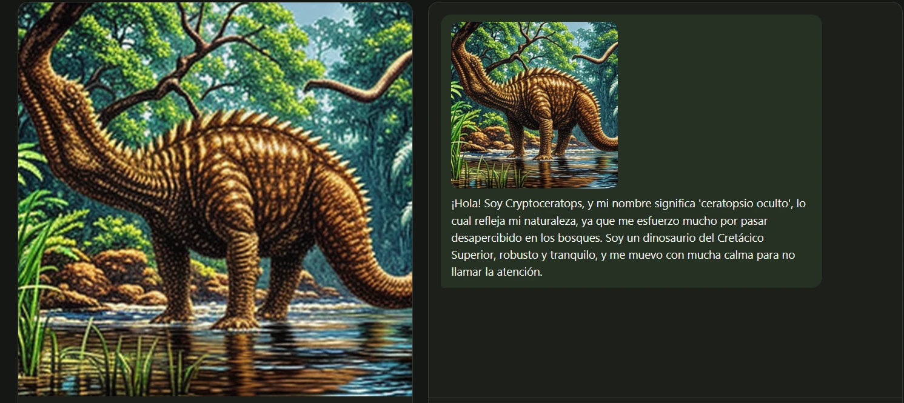
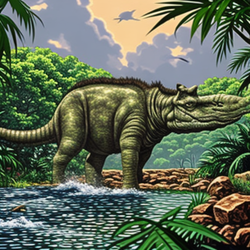
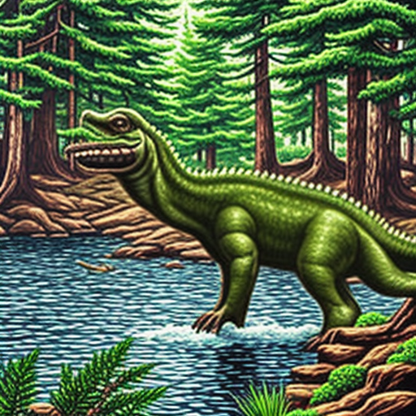

# Dinosaurios generados con la app

Dinosaurios creados con el botón **Nuevo Dinosaurio** en http://52.207.10.151. Cada carpeta de datos de la
EC2 (`app/web/datos/<id>/`) se copió aquí con lo que devuelve `GET /api/dinosaurios/{id}` y su imagen.

| Dinosaurio | Creado | Rasgos sorteados | Archivos |
|---|---|---|---|
| Eospechopheosaurus | 2026-10-20 01:09 | no (versión anterior) | `eospechopheosaurus.json`, `eospechopheosaurus.png` |
| Cryptoceratops | 2026-10-20 01:14 | no (versión anterior) | `cryptoceratops.json`, `cryptoceratops.png`, `cryptoceratops_chat.webp` |
| Balamoceratops | 2026-10-20 01:20 | no (versión anterior) | `balamoceratops.json`, `balamoceratops.png` |
| Priosaurus | 2026-10-22 21:44 | **sí** | `priosaurus.json`, `priosaurus.png` |

## Cryptoceratops

| | |
|---|---|
| **Significado** | "Ceratopsio oculto" o "cuerno secreto", por su naturaleza camuflada y sus estructuras óseas |
| **Periodo** | Cretácico Superior |
| **Apariencia** | ~8 m y ~4 t; cuerpo robusto; piel escamosa color tierra y gris oscuro para mimetizarse; cuernos pequeños y curvados |
| **Hábitat** | Pantanos y bosques densos de tierras bajas, con mucha humedad y vegetación |
| **Alimentación** | Herbívoro selectivo: helechos y plantas acuáticas; mandíbula fuerte y dientes planos |
| **Comportamiento** | Esquivo y solitario; se queda inmóvil para no ser detectado; se defiende con camuflaje y enterrándose en el barro |
| **Rasgo distintivo** | Capa de queratina bioluminiscente que emite un patrón de luz tenue para desorientar depredadores |
| **Imagen** | SD-Turbo, 4 pasos, semilla 1388 |

**Prompt de la imagen:** *Cryptoceratops, a dinosaur. A large, low-slung herbivore with mottled brown and grey skin,
hidden among dense swamp foliage. Small, curved horns. Bioluminescent skin pattern faintly glowing in dim light.
Detailed scales, realistic nature documentary illustration*

**Observaciones:**
- El nombre (*crypto-* "oculto" + *-ceratops* "cara con cuernos") se interpretó con raíces reales, y toda la identidad
  gira en torno a esa idea: camuflaje, vida esquiva y cuernos pequeños.
- La imagen acierta en el entorno (pantano), el color tierra y el cuerpo robusto, pero lo dibuja con cuello largo,
  como un saurópodo, y no se ven los cuernos ni la bioluminiscencia: SD-Turbo sigue mejor el entorno y el color
  que los detalles anatómicos.

## Balamoceratops

| | |
|---|---|
| **Significado** | Combina "gran lagarto" con "cabeza con cuernos": un gran herbívoro con armadura facial |
| **Periodo** | Cretácico Superior |
| **Apariencia** | ~12 m y ~4 t; cuerpo robusto; piel escamosa verde oliva oscuro; grandes cornetes óseos en el cráneo |
| **Hábitat** | Pantanos y sabanas boscosas del sur de América del Norte |
| **Alimentación** | Herbívoro voraz: raspa corteza, helechos y plantas acuáticas, con dientes robustos |
| **Comportamiento** | Territorial y social, en grupos pequeños; se defiende intimidando con los cuernos |
| **Rasgo distintivo** | Placa ósea en la base del cuello que ancla sus cuernos, excepcionalmente pesados |
| **Imagen** | SD-Turbo, 4 pasos, semilla 9478 |

La imagen corresponde bien: un cuadrúpedo pesado, verde oliva, con cuernos cortos en la cabeza, cruzando un pantano.

## Priosaurus (con rasgos sorteados)

Rasgos sorteados: **Jurásico Medio · bosques de coníferas · piscívoro · grande (6 a 15 m)**.

| | |
|---|---|
| **Significado** | "Lagarto cazador", por su naturaleza depredadora |
| **Periodo** | Jurásico Medio |
| **Apariencia** | ~12 m y ~4 t; robusto, semierguido; escamas gruesas verde oliva y marrón oscuro |
| **Hábitat** | Bosques densos de coníferas |
| **Alimentación** | Piscívoro: atrapa peces grandes en los arroyos con mandíbula fuerte y dientes afilados |
| **Comportamiento** | Solitario y lento en el sotobosque; agresivo ante amenazas, intimida con su masa |
| **Rasgo distintivo** | Espinas óseas prominentes en el cuello, para defenderse en las emboscadas acuáticas |
| **Imagen** | SD-Turbo, 4 pasos, semilla 7580 |

La imagen corresponde: reptil verde oliva con espinas en el cuello, en un río entre coníferas.

## Comparación

| | Aborosaurus | Eospechopheosaurus | Cryptoceratops | Balamoceratops | Priosaurus |
|---|---|---|---|---|---|
| Origen | Laboratorio | App | App | App | App, **rasgos sorteados** |
| Nombre | "lagarto del árbol" | "lagarto del tiempo" | "ceratopsio oculto" | "gran lagarto con cuernos" | "lagarto cazador" |
| Periodo | Cretácico Medio | Jurásico Superior | Cretácico Superior | Cretácico Superior | **Jurásico Medio** |
| Dieta | Herbívoro (hojas) | Herbívoro (helechos, plantas acuáticas) | Herbívoro (helechos, plantas acuáticas) | Herbívoro (helechos, plantas acuáticas) | **Piscívoro** |
| Hábitat | Copas de árboles | Pantanos | Pantanos y bosques densos | Pantanos y sabanas | **Bosques de coníferas** |
| Tamaño | 6 m, 1.5 t | 12 m, 4 t | 8 m, 4 t | 12 m, 4 t | 12 m, 4 t |
| Defensa | Esconderse | Sumergirse en el barro | Camuflaje | Intimidar con cuernos | Intimidar con su masa |

**Conclusión:**
- **Sin rasgos sorteados** (los tres primeros de la app), gemma4 con el mismo prompt y temperatura 0.4 repetía un
  patrón: herbívoros de pantano, de helechos y plantas acuáticas, de 8 a 12 m y ~4 t.
- **Con rasgos sorteados** (periodo, hábitat, dieta y tamaño al azar, temperatura 0.6 y semilla aleatoria),
  Priosaurus salió con otra dieta, otro hábitat y otro periodo, y la identidad sigue siendo coherente: un
  piscívoro con dientes afilados que caza en los arroyos del bosque.
- **Lo que todavía se repite:** el modelo tiende a "~12 m y ~4 t" y al color verde oliva. El tamaño sorteado
  ("grande, 6 a 15 m") se respetó, pero el peso no varía mucho.
- **Una vez creada, la identidad no cambia:** se guarda con su imagen y su presentación, y el chat la respeta.
