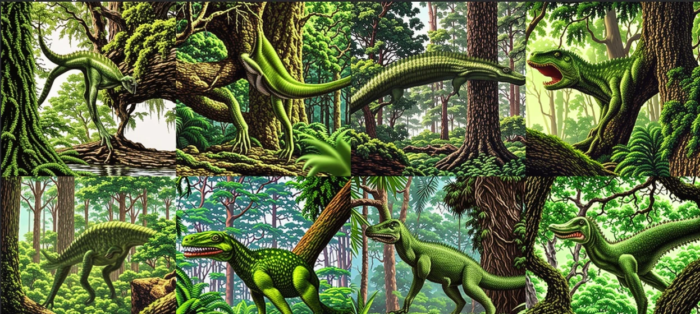

# Imagen del dinosaurio (text-to-image)

| Archivo | Qué es |
|---|---|
| `generar_imagen.ipynb` | Notebook para Google Colab (GPU T4): mismo prompt con `amused/amused-512` y `stabilityai/sd-turbo`, 8 semillas cada uno |
| `aborosaurus.png` | **Imagen final** (SD-Turbo, semilla 6, 512×512), la que usa la app y el chat |
| `candidatas_sd_turbo.webp` | Las 8 candidatas de SD-Turbo (arriba semillas 0-3, abajo 4-7) |
| `imagen_info.json` | Modelo, prompt, pasos, guía, semilla y GPU de la imagen final |
| `ronda1/` | Primera ronda con aMUSEd: candidatas, imagen y configuración |

**Entrada:** nombre y rasgos de `ollama/identidad.json`.
**Salida:** `aborosaurus.png`. Se genera una sola vez por dinosaurio y se reutiliza.

## Ronda 1: aMUSEd con el prompt de Ollama

Prompt: el `prompt_imagen` que escribió Ollama (*"A medium-sized, slender dinosaur with long limbs clinging
to a massive tree branch…"*), 12 pasos, guía 10.0, semillas 0 a 3.

Ninguna convenció: las imágenes salieron oscuras, con cabezas con forma de pico (semilla 0), cuerpos
pesados de cuadrúpedo (1), color azulado (2) o dientes de carnívoro (3). aMUSEd es un modelo enmascarado
liviano que trabaja con fichas discretas de un VQ-GAN; pierde detalle y sigue mal las poses.

## Ronda 2: prompt más concreto y comparación de modelos

Se reescribió el prompt con rasgos visuales concretos y estilo, y se agregó un prompt negativo con lo que
contradice la identidad:

| | |
|---|---|
| Prompt | `Aborosaurus, a slender olive-green herbivorous dinosaur climbing a thick mossy tree trunk, long legs gripping the bark, small head, long tail, detailed scales, dense humid rainforest canopy, soft dappled sunlight, realistic nature documentary illustration` |
| Prompt negativo (solo aMUSEd) | `beak, bird, pterosaur, sharp teeth, quadruped, heavy body, blurry, deformed, extra limbs, text, watermark, cartoon` |

Se compararon dos modelos de tamaño similar:

| | `amused/amused-512` | `stabilityai/sd-turbo` |
|---|---|---|
| Tipo | Modelo enmascarado (MUSE) sobre fichas VQ-GAN | Difusión latente destilada (ADD) de Stable Diffusion 2.1 |
| Tamaño aprox. | ~800 M parámetros | ~1 300 M parámetros |
| Pasos / guía | 12 / 10.0 | 4 / 0.0 (no usa prompt negativo) |

SD-Turbo dio imágenes nítidas y coherentes con la identidad:

| Semilla | Resultado |
|---|---|
| 1 | Trepado en el tronco, el rasgo distintivo, pero el cuerpo se ve poco |
| 5 | La más vistosa, pero la boca abierta con dientes puntiagudos parece de carnívoro |
| **6** | **Elegida:** esbelto, patas largas, cabeza pequeña, cola larga, verde, en bosque húmedo junto a un tronco; boca casi cerrada |
| 7 | Esbelto junto al tronco, pero con la boca más abierta |
| 3 | Boca roja muy abierta, estilo tiranosaurio |

La semilla 6 equilibra calidad y coherencia con la identidad. Está en el suelo y no trepando: es la
diferencia que queda frente a la descripción.
