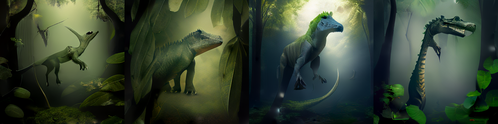

# Imagen del dinosaurio (text-to-image)

| Archivo | Qué es |
|---|---|
| `generar_imagen.ipynb` | Notebook para Google Colab (GPU T4): carga `amused/amused-512`, genera 4 candidatas y guarda la elegida |
| `aborosaurus.png` | Imagen elegida (512×512), la que usa la app y el chat |
| `candidatas.png` | Las 4 candidatas (semillas 0 a 3) |
| `imagen_info.json` | Prompt, prompt negativo, pasos, guía, semilla y GPU |

**Entrada:** nombre y `prompt_imagen` de `ollama/identidad.json`.
**Salida:** `aborosaurus.png`. Se genera una sola vez por dinosaurio y se reutiliza.

## Configuración

| | |
|---|---|
| Modelo | `amused/amused-512` (fp16) con `diffusers` |
| Entorno | Google Colab, Tesla T4 |
| Prompt | `Aborosaurus, a dinosaur. A medium-sized, slender dinosaur with long limbs clinging to a massive tree branch in a dense, humid forest canopy. Olive green scales, browsing on leaves. Soft, dappled sunlight.` |
| Prompt negativo | `blurry, low quality, text, watermark, deformed, extra limbs, cartoon` |
| Pasos / guía | 12 / 10.0 |
| Resolución | 512×512 |

## Candidatas

| Semilla | Resultado | ¿Encaja con la identidad? |
|---|---|---|
| **0** | Esbelto, verde oliva, patas largas, en un bosque húmedo con niebla | ✅ Elegida |
| 1 | Cuadrúpedo robusto entre hojas | Demasiado pesado para un trepador |
| 2 | Bípedo azul verdoso con cresta | El color se aleja del verde oliva |
| 3 | Cuello largo y mandíbula con dientes de carnívoro | Contradice la dieta herbívora |

Ninguna lo muestra agarrado a una rama: aMUSEd es un modelo pequeño y sigue mal las poses concretas.
La semilla 0 conserva lo principal de la identidad: cuerpo esbelto, color verde oliva y entorno de bosque húmedo.

